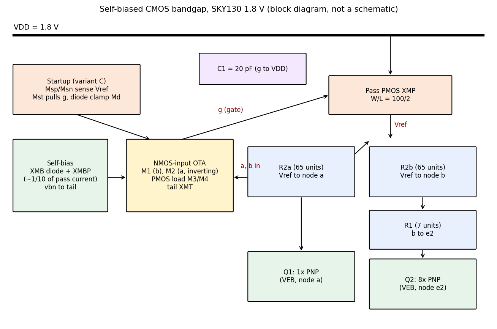
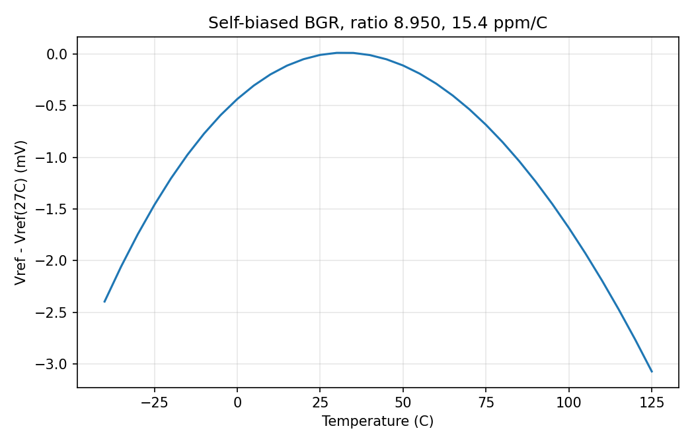
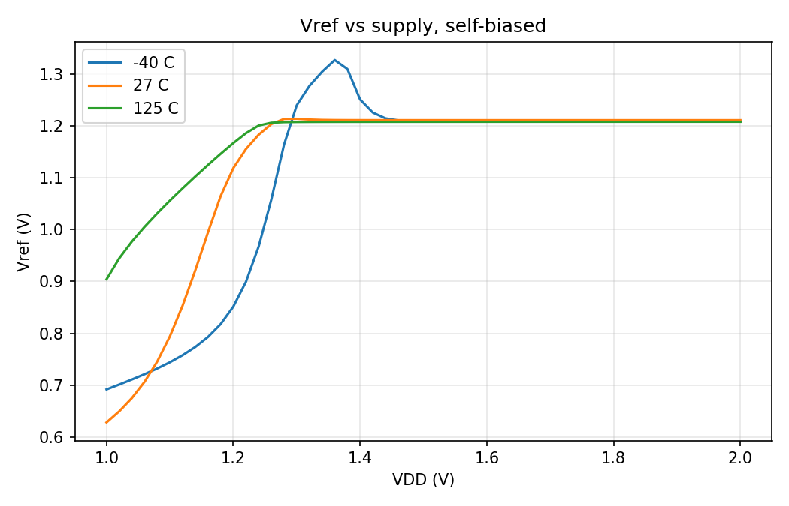
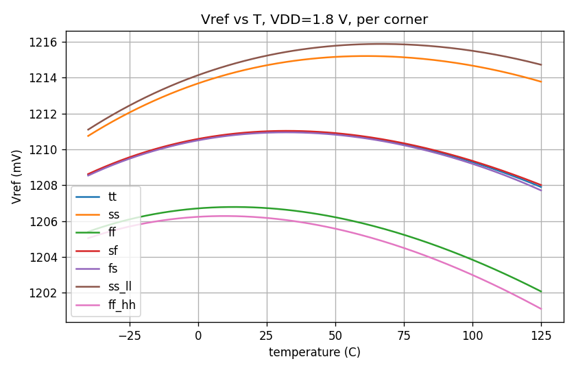
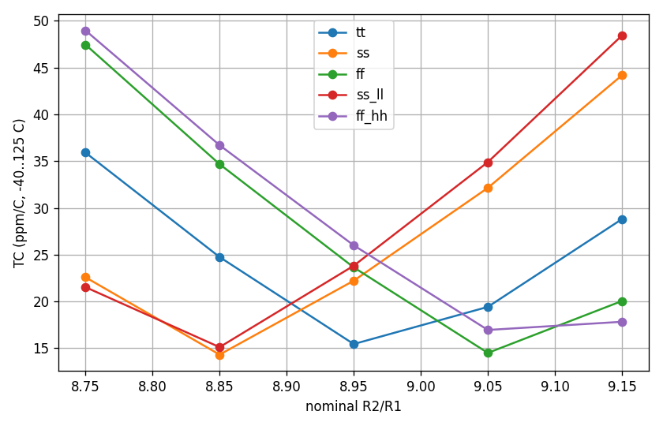
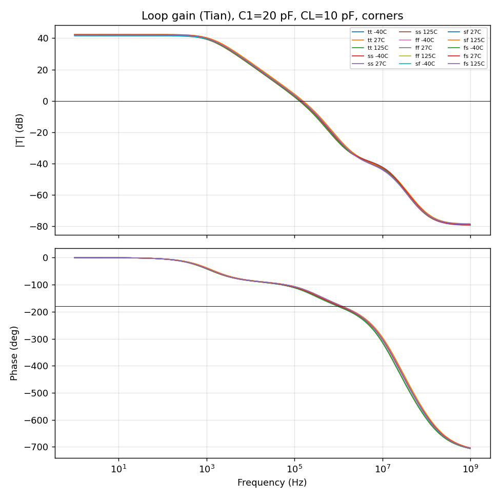
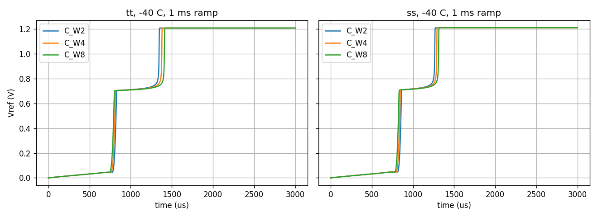
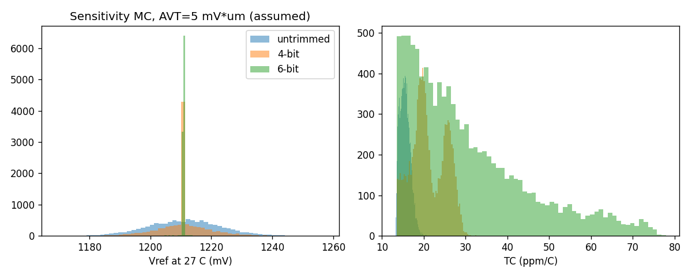

# PVT-robust self-biased CMOS bandgap reference (SKY130, 1.8 V)

A schematic-level bandgap reference designed with real SKY130 PDK devices (PNP, `xhigh_po_2p85` poly resistors, MOS), verified with scripted ngspice runs: temperature, supply, process corners, loop stability, startup, load regulation, noise, a sensitivity-based Monte Carlo and a trim study.

**Scope.** All results are schematic-level (no layout, no parasitics) and untrimmed unless stated. Layout/DRC/LVS/PEX was deliberately skipped. Failures and limitations are listed in this README, not hidden.

## Design

- Vref = VEB + (R2/R1) * VT * ln(N), N = 8, 5 uA per branch. Nominal tt: VEB ~ 0.7219 V, R1 ~ 10.76 kOhm, R2/R1 = 8.95.
- Resistors: `sky130_fd_pr__res_xhigh_po_2p85` unit chains. R1 = 7 units, R2 = 65 units per branch.
- Amplifier: NMOS-input OTA (a PMOS-input OTA does not work at 1.8 V in SKY130, see decision log), PMOS pass device W/L = 100/2, C1 = 20 pF from pass gate to VDD, no Miller capacitor.
- Self-biased: the OTA tail current is mirrored from the pass-device current (about 1/10, PTAT), so no external bias is needed.
- Startup: variant C, a pull-down on the pass gate through a diode-connected NMOS clamp, triggered by low Vref.
- Specified maximum load: CL = 10 pF (provisional).

## Measured results

Conditions are given in every row. No formal targets were fixed in advance except the CL limit, so this is a results table, not a target-vs-achieved table.

| Metric | Result | Conditions |
|---|---|---|
| Vref | 1.2110 V | tt, 27 C, VDD 1.8 V |
| Temperature coefficient | 15.45 ppm/C | tt, -40..125 C, 1 C steps, box method (15.4 at 5 C steps) |
| Vref at -40 / 27 / 125 C | 1.2086 / 1.2110 / 1.2079 V | tt, VDD 1.8 V |
| Quiescent current | 13.51 uA (27 C), 19.93 uA (125 C) | tt, VDD 1.8 V |
| Line regulation | -0.099 / 0.020 / 0.160 mV/V | tt, 1.62-1.98 V, at -40 / 27 / 125 C |
| Line regulation, all corners | within +-0.23 mV/V, except sf at -40 C: -0.356 mV/V | 7 corners, end points only |
| Min VDD, Vref within 0.5% | 1.26-1.30 V | tt (step 6c) |
| Vref over 7 corners, -40..125 C | 1.2011-1.2159 V | ratio frozen at tt value |
| Loop phase margin | 61.4-65.3 deg | 5 corners x 3 temps, C1 20 pF, CL 10 pF, VDD 1.8 V; worst ff at -40 C |
| Loop gain margin | 25.8-27.3 dB | same; unity-gain freq 0.129-0.157 MHz |
| PSRR (10 Hz / 1 kHz / 100 kHz / 1 MHz / 10 MHz) | 92.5 / 80.8 / 42.3 / 33.6 / 28.7 dB | tt, 27 C, CL 1 pF, C1 20 pF only (other corners/temps not measured) |
| Startup overshoot | 0.0 mV (+0.2 mV at 125 C, 1 ms ramp) | tt, -40/27/125 C, 1 us / 10 us / 1 ms ramps, no nodesets, CL 1 pF |
| Startup settle (1%) | 1 us ramp 10.4/7.7/7.8 us; 10 us ramp 18.7/15.8/15.6 us; 1 ms ramp 1349.5/1115.8/770.1 us | tt, -40/27/125 C |
| Startup at -40 C, other corners | 1 ms ramp settles at 1452.6 (ff), 1506.6 (sf), 1020.4 (fs) us; 0.0 mV overshoot | no nodesets; 27/125 C at these corners not tested |
| Load regulation, slope 0-100 uA | -2.0 / -9.4 / -54.6 mV/mA | tt, DC, -40 / 27 / 125 C |
| Noise 0.1-10 Hz | 107.4 / 108.9 / 116.5 uVrms | tt, -40/27/125 C, CL 1 pF, no output filter |
| Noise 10 Hz-100 kHz | 236.7 / 255.0 / 288.0 uVrms | same |
| Spot noise at 1 Hz / 1 kHz (27 C) | 50,517 / 2,100 nV/rtHz | same |

**Corner TC, ratio frozen at the tt value (step 7c):** tt 15.45, ss 22.22, ff 23.65, sf 15.11, fs 16.19, ss_ll 23.82, ff_hh 26.00 ppm/C (VDD 1.8 V, 1 C steps).

**With the ratio re-tuned per corner (step 7d, 1 C steps):** best TC on the grid 14.32 (ss), 14.50 (ff), 15.12 (ss_ll), 16.96 (ff_hh), 15.45 (tt) ppm/C. The corner spread is almost entirely a ratio offset, which is what trim addresses. Needed ratio range is about 8.85-9.09 (interpolated optima are estimates).

## Plots

**Vref vs temperature, tt, VDD 1.8 V (step 6c).**

**Vref vs supply, tt (step 6c).**

**DC over process corners, ratio frozen at tt value (step 7c).**

**TC vs R2/R1 ratio per corner (step 7d).**

**Loop-gain results over corners and temperatures, C1 = 20 pF, CL = 10 pF (step 7e).**

**Cold (-40 C) 1 ms-ramp startup, showing the plateau and recovery (step 7b).**

**Sensitivity-based Monte Carlo, tt, assumed AVT (step 8b).**

## Monte Carlo and trim (sensitivity-based, not device-level)

The PDK models do not provide per-instance mismatch without editing them, so the Monte Carlo maps mismatch sources onto two measured sensitivities (step 8a, tt): dVref/dVos = -11.0 to -11.1 V/V (OTA input offset, nearly flat over temperature) and dVref/d(ratio) of 0.43 / 0.50 / 0.55 / 0.65 / 0.72 mV per 0.01 at -40 / 0 / 27 / 85 / 125 C. The linear model reproduces the step 7d TC values to within 0.05 ppm/C at the ratio offsets checked.

**Assumptions, all of which apply to every number below:** Pelgrom AVT = 3 / 5 / 8 mV*um (assumed, not extracted from the PDK); load-transistor offset counted at 0.5 of the input pair's (unmeasured); PNP Is sigma = 0.13 x 0.01662; resistor end-resistance mismatch 0.0472/sqrt(w); the R2a/R2b sign convention is unverified (it contributes 0.16 mV). Trim: 6-bit codes, ratio step 0.015, offset step 0.1 mV input-referred. The trim hardware is not designed. 10,000 samples, tt, mismatch only.

| AVT (mV*um) | Strategy | Vref sigma (mV) | Max dev (mV) | TC mean +- sigma (ppm/C) |
|---|---|---|---|---|
| 5 | untrimmed | 11.86 | 46.53 | 15.53 +- 1.22 |
| 5 | a: Vref trim via ratio | 0.95 | 20.31 | 30.49 +- 14.25 |
| 5 | b: TC trim via ratio | 11.67 | 46.53 | 13.86 +- 0.23 |
| 5 | c: offset trim, then TC ratio trim | 0.92 | 13.10 | 13.86 +- 0.16 |

Untrimmed Vref sigma is 7.15 / 11.86 / 18.95 mV at AVT = 3 / 5 / 8; strategy c gives 0.89 / 0.92 / 2.63 mV at AVT = 3 / 5 / 8. The OTA dominates the spread (pair 7.8 mV, load 8.6 mV, PNPs and resistors under 1 mV each at AVT = 5).

**Finding:** ratio trim alone cannot fix Vref and TC together when the dominant error is amplifier offset. The offset gain is flat over temperature while the ratio knob's gain grows with temperature (hypothesis consistent with the curves), so cancelling Vref at 27 C leaves a TC error. Offset trim first, then a TC ratio trim, works best. The 13.86 ppm/C floor is the tt curvature at the 0.015 ratio grid, not a mismatch effect. The TC trim here picks the best code from the full -40..125 C curve; real trimming at 2-3 temperatures would do somewhat worse.

## Design-decision log

1. **PMOS-input OTA rejected.** Vsg is about 1.07 V at 1 uA and the tail starves at 1.8 V. The NMOS-input OTA works. Vgs at 1 uA, W/L = 10/2, at -40 / 27 / 125 C: PFET 1.177 / 1.067 / 0.904 V, NFET 0.599 / 0.545 / 0.470 V.
2. **Solver-tolerance artifact.** Default `reltol` produced a fake 21.0 ppm/C. All results use `reltol=1e-6 vntol=1e-9 abstol=1e-14`. Early step-5b numbers (default tolerance, ideal resistors, ideal bias) are discarded.
3. **Miller capacitor (Cc = 3 pF) rejected.** It raised phase margin (87 / 84 / 57 deg at CL 1 / 10 / 100 pF) but PSRR collapsed (42 dB at 1 kHz and about 5 dB at 100 kHz, versus 89 / 52 dB) and startup failed at -40 C (Vref stuck near 0.6 V). The cause is untested. Lesson: stability alone is not a design criterion; recheck PSRR and startup after any compensation change.
4. **C1 raised from 2 pF to 20 pF.** Needed for phase margin at CL = 10 pF (C1 = 2 pF gave 21-23 deg at 10 pF; C1 = 20 pF gives 61.4-65.3 deg over 5 corners x 3 temps). Cost: PSRR at 1 kHz falls from 89.3 to 80.8 dB (tt, 27 C, CL 1 pF). My earlier prediction that PSRR would improve with C1 was wrong.
5. **Startup overshoot fix.** The original pull-down dragged the gate near 0 V and overdrove the pass device. Weakening Mst or enlarging Msn did not help; clamping the pull-down with a diode-connected NMOS (variant C) removed the overshoot (baseline +572.7 / +246.7 mV at 1 / 10 us ramps at -40 C, variant C 0.0 / 0.0 mV). The overdrive mechanism is a hypothesis supported by the fix, not separately proven.
6. **Cold slow-ramp delay found after calling startup clean.** At -40 C with a 1 ms ramp, Vref plateaus near 0.71-0.73 V for about 200-350 us after VDD reaches 1.8 V, then recovers to 1.2086 V. It is a delay, not a failure. My first explanation (clamp holding the gate, pass device starved) was refuted by measurement (pass Vsg during the plateau is 0.95-0.98 V). The real mechanism is unknown. Clamp diode W = 2 was kept; wider diodes slow the 1 ms ramp (1349.5 / 1382.5 / 1413.5 us for W = 2 / 4 / 8, tt).
7. **Trim strategy.** A 4-bit ratio trim for Vref was proposed first and was inadequate (it worsens TC), which led to the offset-then-ratio strategy.
8. **Line regulation claim corrected.** "<0.2 mV/V" holds only for tt; across corners it is below 0.36 mV/V.

## Limitations

- Maximum load CL = 10 pF. CL = 100 pF is unsupported (PM about 23 deg at -40 C, tt, C1 = 20 pF, step 6e). PM at CL = 1 pF with C1 = 20 pF was not measured.
- Cold slow-ramp startup delay of several hundred us with unknown mechanism. Startup at ff/sf/fs only at -40 C; not tested at 27/125 C, for the 10 us ramp at those corners, for ramps slower than 1 ms, or with process and R/C corners combined.
- High noise (about 109 uVrms in 0.1-10 Hz at 27 C), mostly 1/f. The likely source (OTA input pair and load, gained about 11x) is a hypothesis; noise was not split by device.
- Load regulation slope grows strongly with temperature (-54.6 mV/mA at 125 C). Output impedance was not measured separately.
- PSRR measured only at tt, 27 C, CL = 1 pF. No line or load transients.
- No layout, no parasitic extraction, no DRC/LVS.
- Monte Carlo is sensitivity-based with assumed AVT and load-offset weighting; no combined corner + mismatch; trim hardware not designed.
- Headroom minima at VDD 1.62 V were recorded (tail Vds 0.099 V at fs/125 C, M1/M2 Vds 0.150 V at sf/-40 C) but Vdsat was not measured, so they are not pass/fail.

## Reproducing

Scripts are in `scripts/`; each writes an ngspice netlist, runs it and saves JSON/PNG to `results/`. PDK: SKY130A (ciel commit 792ef67037d74c8c51811eab3ce23cf793491296), ngspice 36. Key scripts: `step6c` (DC/temperature), `step7c`/`step7d` (corners, ratio), `step7e` (loop gain), `step6i`/`step7b`/`step9b` (startup, load regulation), `step9a` (noise), `step8a`-`step8c` (Monte Carlo and trim).
